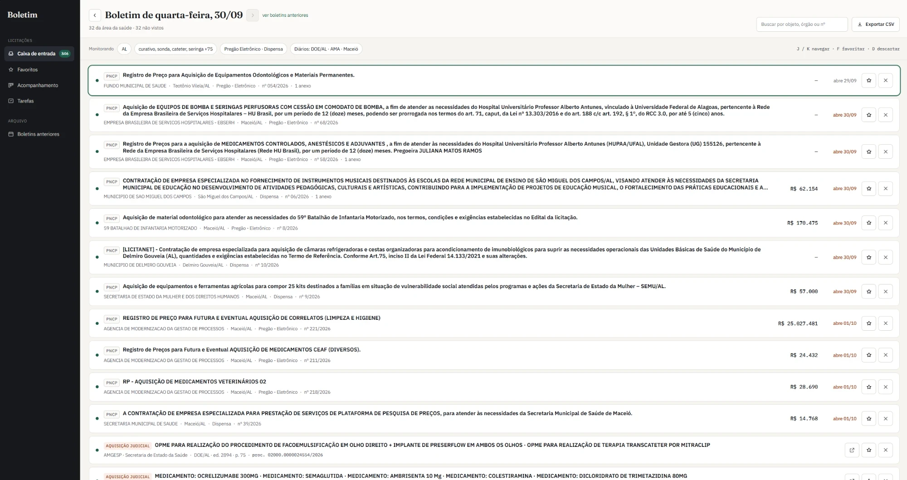
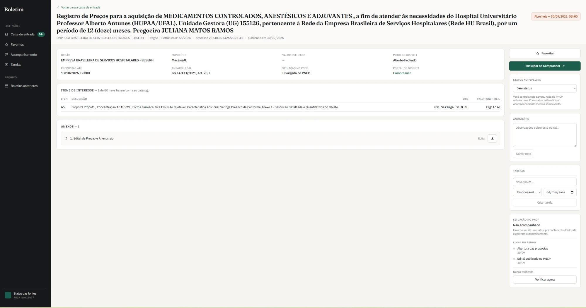

# Public Procurement Monitor — Healthcare

**English** · [Português](README.md)

[](https://github.com/Eduardo-Brrs/monitor-licitacoes-saude/actions/workflows/ci.yml)

A system that monitors public procurement notices (*licitações*) for the healthcare sector in Alagoas, Brazil. It was built for internal use at a medical and hospital supplies distributor, to replace a paid procurement alert subscription.

Every day the system scans the official public procurement sources, filters what matches the company's catalog and delivers a **daily bulletin** for triage. Selected notices move into a management flow with stages, tasks, a timeline and automatic result detection. What the company wins becomes a price registration record or contract, with order and balance tracking.

> **Status:** in internal use, in production since August 2026. This repository is a snapshot of the code, published as a portfolio piece; development happens in a private repository, together with the data, the credentials and the production instance. The UI, the ADRs and the code comments are in Portuguese.


<sub>Daily bulletin: notices from PNCP and announcements from the official gazettes in a single list, sorted by deadline, with keyboard triage (J/K to move, F to favorite, D to dismiss).</sub>


<sub>Notice detail: only the items that match the catalog (1 of 80 in this example), attachments, stage, tasks and timeline.</sub>

---

## The problem

A company that sells to the government needs to know, every day, which agencies opened purchases for its products. Today that goes through paid services that aggregate procurement notices. The company used one of them, and the day-to-day users' complaints were:

- **Built for every industry, not for healthcare.** The platform serves everyone from construction firms to print shops. For a healthcare supplier that means filtering bulletins full of irrelevant items by hand, and still missing opportunities specific to the sector, such as court-ordered purchases of medical implants (OPME) and medicines.
- **Too many options.** The screen is packed with modules, menus, filters and settings, and most of them were useless for his work. The owner complained a lot about how much the platform had: opening it felt overwhelming before he even started. What he wanted was something lean, easy to use and focused on his industry: open it, see what's new and decide in seconds.
- **Expensive for what it delivers.** You pay for the whole package and use a fraction of it.

That's why the project's guiding principle is **do less, and do it right**: only the features the user actually uses, with the filter tuned to the catalog of a medical and hospital supplies distributor. One feature (AI reading of procurement documents) was dropped during planning because the paid service had it and nobody used it.

The information is public, but scattered:

- **PNCP** (Brazil's National Public Procurement Portal) has an open API, but it goes down often and doesn't have everything;
- **court-ordered purchases** (emergency purchases the State makes under a court order, such as medical implants and medicines) and **price quotation requests** are only published in the **State Official Gazette**;
- municipalities publish notices and quotation requests in **municipal official gazettes**, sometimes before PNCP.

The project brings these sources together in one place, with a filter tuned to the company's real catalog.

## What it does

### Find

- **Automatic capture, several times a day**, from four sources:
  - PNCP: electronic reverse auctions (*Pregão Eletrônico*) and direct purchases (*Dispensa*) in Alagoas;
  - Alagoas State Official Gazette: court-ordered purchases, state auctions and quotation requests;
  - municipal gazettes (AMA, Maceió and Maceió Saúde): procurement notices, direct purchases and quotation requests.
- **Keyword filter** with a custom text-matching engine (details below), organized by segment (medical and hospital supplies, equipment, medical gases, radiology, enteral nutrition, medicines, hygiene), also covering laboratory and dental supplies.
- **Background check of every item in a purchase.** When the purchase's overall description matches no keyword, its items go into a queue and are checked one by one (e.g. "purchase of assorted equipment" with an ultrasound machine as item 14).
- **Daily bulletin:** a single list sorted by urgency, with keyboard triage (seen / favorite / dismiss / undo).
- **Procurement search:** search by text, agency, city, state, government level and segment in a single list, combining what's already in the system with a **live search of the PNCP portal**, in any state, to find what the automatic capture missed. Filters live in the URL, so a search can be bookmarked and exported to CSV.
- **Announcement linked to the notice:** when a tracked gazette announcement later shows up on PNCP, the system finds the matching notice and links the two.

### Decide and track

- **Notice page:** items that match the catalog, attachments (with a local copy of the list and a streaming `.zip` download of all of them) and a link to the bidding portal.
- **Manage bids:** each bid moves through a ladder of stages (favorited → managed → in progress → finished / won), with the owner and the next task shown on the row itself.
- **Finish with a result:** when closing a bid, the user records what happened (won all items, some or none; annulled, failed, revoked; didn't bid) and the amount won.
- **Per-bid timeline:** notes with author and date, stage changes, tasks created, answered and completed, and PNCP events in a single list. Edited notes keep their previous version.
- **Automatic results:** the system periodically re-queries PNCP and records award, price registration record, signed contract and postponed openings. When the winner has the company's tax ID (CNPJ), it **suggests marking the bid as "won"** (it never does it on its own).
- **Tasks** with an owner and a due date, grouped into overdue, next 7 days and later.

### After winning

- **Price registration records and contracts:** replaces the spreadsheet the company used. Each record has the items won, the orders placed and the **balance left to order**, with tabs by validity (active, expiring in 60 days, expired) and an export in the same layout as the old spreadsheet.

### Operations

- **Source health:** a page showing the health of each capture (last success, consecutive failures, error explained in plain Portuguese). It lights up a global warning when a source stops running, or when it answers "success" with zero items where zero is abnormal.
- **Schedule watchdog:** checks 8 times a day that each job started on time; if one didn't, it runs the job itself and sends an email alert.
- **Archive** of past bulletins and **CSV export** compatible with Excel in Portuguese (`;` + BOM).
- **Automatic cleanup** of old data, so the database fits in the free tier for years.

## Architecture

```
 cron-job.org (scheduler)                  Vercel (Next.js)                         Neon (Postgres)
┌──────────────────────┐   Bearer    ┌──────────────────────────────┐          ┌──────────────────────┐
│ sync             3x/d│────────────▶│ /api/sync          ─ PNCP    │─────────▶│ editais              │
│ sync-doe         3x/d│────────────▶│ /api/sync-doe      ─ DOE-AL  │─────────▶│ doe_al_*             │
│ sync-diarios     3x/d│────────────▶│ /api/sync-diarios-municipais │─────────▶│ diario_municipal_*   │
│ verificar-itens 30min│────────────▶│ /api/verificar-itens         │─────────▶│ itens_pendentes      │
│ atualizar-det.  30min│────────────▶│ /api/atualizar-detalhes      │          │ edital_status, notas │
│ acompanhar      30min│────────────▶│ /api/acompanhar              │─────────▶│ edital_eventos       │
└──────────────────────┘             │                              │          │ tarefas, atas        │
 GitHub Actions (backup)             │ App Router + Server Actions  │◀────────▶│ sync_runs            │
┌──────────────────────┐             │ (bulletin, search, records…) │          │ fila_falhas          │
│ watchdog         8x/d│────────────▶│ /api/vigia                   │          └──────────────────────┘
│ CI     on push / PR  │             └──────────────────────────────┘
└──────────────────────┘
```

**Stack:** Next.js 16 (App Router, Server Components, Server Actions) · React 19 · TypeScript · Tailwind CSS v4 · serverless PostgreSQL (Neon, `@neondatabase/serverless` driver) · Vercel · cron-job.org and GitHub Actions · `pdf-parse` to read the official gazettes. There are **5 production dependencies**; zip, CSV, tests and migrations use custom code or Node itself.

## Engineering

### Decisions recorded as ADRs

Architecture decisions live in [`docs/adr/`](docs/adr/README.md) (in Portuguese), as *Architecture Decision Records*: context, decision, rejected alternatives, consequences and a **"How it looks today"** section that says whether the decision still holds. Some examples:

- [0002](docs/adr/0002-fontes-e-agendamento.md): why sources are public only, why PDF reading exists as a fallback and why scheduling moved off GitHub Actions;
- [0003](docs/adr/0003-filtro-por-keyword.md): why the filter matches keywords in the text, rather than catalog codes (CATMAT) or AI;
- [0007](docs/adr/0007-login-e-senha.md): login design (scrypt from `node:crypto`, sessions stored as hashes in the database, three layers of checks and a test that fails if a new Server Action forgets to check the session);
- [0012](docs/adr/0012-filas-resilientes.md): the rule that one failing item never stops a queue;
- [0010](docs/adr/0010-revisao-e-licoes.md): an honest review of the decisions — what worked, what was costly and the lessons for the next project.

### Tests and CI

- **`npm test`** uses Node's built-in test runner, with no new dependency. It covers the keyword engine, the resilient queue, the watchdog and the detection of sources returning zero items.
- **Regression test with real data:** over 800 real purchase descriptions from PNCP are kept in a snapshot (`tests/fixtures/objetos-pncp.json`) with the keywords each one must match. Any change to the engine shows exactly what each description lost or gained; an intentional change requires committing the new snapshot alongside it.
- **CI on GitHub Actions** on every push and PR: generates Next's route types, runs `tsc --noEmit` and the tests. Deploys only go out with green CI.

### Versioned database migrations

Database changes live in [`migrations/`](migrations), numbered. `npm run migrate` applies only the pending ones, each file in a single transaction, and stores a hash of each: if an already-applied file is edited, the script warns about it.

### Technical decisions worth highlighting

**Unstable sources are the rule, not the exception.** PNCP has real, recurring outages, sometimes longer than an hour. So:
- every external call has a timeout (`AbortSignal.timeout`), retries with backoff and a time budget, so the serverless function never hits `maxDuration` without recording what happened;
- every run re-queries a window of several days (7 for PNCP, 14 for the State Gazette). Inserts are idempotent (`ON CONFLICT DO NOTHING` on canonical keys), so re-querying is free and a day-long outage doesn't lose notices;
- every run is recorded in `sync_runs`, which feeds both the source health page and the watchdog.

**One failing item never stops a queue** (`lib/fila.ts`). This happened twice: a notice stuck on PNCP burned 16 runs in a row, and a 16 MB State Gazette PDF held back the following editions for over 38 hours. Today every job that walks through items uses the same function, with failure isolation, rotation (a failed item goes to the back of the queue), a time budget and an alert when an item is stuck for 24 hours. A test fails if a job stops using it.

**Three layers of fallback.** Isolation and rotation keep each queue moving; the watchdog runs any job that didn't start; and each source's re-query windows and alternative paths recover what was missed. The [`docs/operacao.md`](docs/operacao.md) guide (in Portuguese) says what to do for each kind of failure.

**Reverse engineering undocumented APIs.** The State Official Gazette is a SPA with no documented API. Its endpoints were mapped from the site's own JS bundle. When their full-text search froze on an index months old (no error, just stale data), an alternative path was built: list the published editions, download each PDF and extract the announcements locally with regexes over the record's fixed format. It also had to handle editions republished with a new ID and supplements that share the regular edition's number.

**Custom keyword engine** (`lib/keywords.ts`), refined case by case by comparing the capture against the paid service's bulletin:
- accent and hyphen normalization, word-boundary matching (so "maca", a stretcher, doesn't match inside "informação");
- plurals on every word of compound terms, including irregular Portuguese plurals (`-al → -ais`, `colchão → colchões`, `álcool → álcoois`);
- tolerance for a space inside a word ("Ultra som" = "ultrassom"), handling the doubled intervocalic "s";
- **compound terms by presence**, without requiring adjacent words (`gás + medicinal` matches "Gás comprimido, nome: oxigênio… característica adicional: medicinal").

**Streaming zip with no dependency** (`lib/zip.ts`). A regular Vercel response is capped at 4.5 MB, so "download all attachments" builds a zip (*store* mode, custom CRC32) straight into the stream: 4 parallel downloads, written in order. Tested with 40 attachments / 38 MB.

**Event time × capture time.** The timeline is append-only, with a unique key per event, and stores separately when the event happened and when it was noticed.

## Structure

```
app/
  page.tsx, boletim/[dia]/     daily bulletin (+ CSV export)
  pesquisa/                    search: system + live PNCP
  edital/[numero]/             notice page, attachments (.zip)
  aviso/[fonte]/[id]/          announcement published only in a gazette
  acompanhamento/, tarefas/    bid management and tasks
  atas/                        price registration records and contracts
  arquivo/, saude/             history and source health
  actions/                     Server Actions
  api/                         routes called by the scheduler and the watchdog
lib/
  pncp.ts, detalhe-pncp.ts, acompanhamento-pncp.ts   PNCP client
  doe.ts, diario-municipal.ts                         official gazettes
  keywords.ts                                         keyword engine
  fila.ts, vigia.ts, saude.ts                         resilience and monitoring
migrations/                    versioned database changes
tests/                         tests (node:test) + real-data snapshot
components/                    UI per page
docs/
  adr/                         architecture decisions
  design/                      UI spec + HTML prototypes
  operacao.md                  what to do when a job stops
.github/workflows/             CI, watchdog and manual job triggers
```

## Running locally

Requirements: Node 20+ and a PostgreSQL database ([Neon](https://neon.tech) has a free tier).

```bash
npm install

# .env.local
DATABASE_URL=postgres://...
CRON_SECRET=any-secret          # protects the /api/* routes
NOME_EMPRESA=My Company         # optional; shown in the UI
CNPJ_EMPRESA=00000000000000     # optional; enables the automatic "won" suggestion

npm run migrate   # applies the migrations in migrations/
npm test          # tests
npm run dev
```

To populate the database, call the capture routes:

```bash
curl -H "Authorization: Bearer $CRON_SECRET" http://localhost:3000/api/sync
curl -H "Authorization: Bearer $CRON_SECRET" http://localhost:3000/api/sync-doe
curl -H "Authorization: Bearer $CRON_SECRET" http://localhost:3000/api/sync-diarios-municipais
```

In production these routes are called by cron-job.org, with the GitHub Actions watchdog as a backup. The job workflows don't run in this public copy, which has no secrets; only CI runs here.

## How it was validated

Before it had a UI, the system ran for weeks alongside the paid service. Every bulletin received was compared item by item against the database, and every missed item had its cause investigated: a missing keyword, a bug in the matching engine, a procurement type out of scope or a source that wasn't being read. That's where the State Gazette sources and most of the keyword engine's rules came from, and it's also the source of the regression test cases. In the most recent bulletins, the capture ties or beats the paid service within the defined scope. The comparison log mentions the company's internal data and was left out of this repository.

## Next steps

- Email and password login ([ADR 0007](docs/adr/0007-login-e-senha.md))
- Faster search: database results first, live PNCP results after
- Evaluate moving hosting to Cloudflare ([ADR 0011](docs/adr/0011-hospedagem.md))
- Measure real usage with the team before building more
- Email alert for new notices and a mobile version

---

Built by [@Eduardo-Brrs](https://github.com/Eduardo-Brrs).
