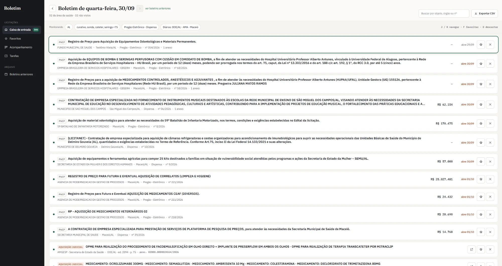
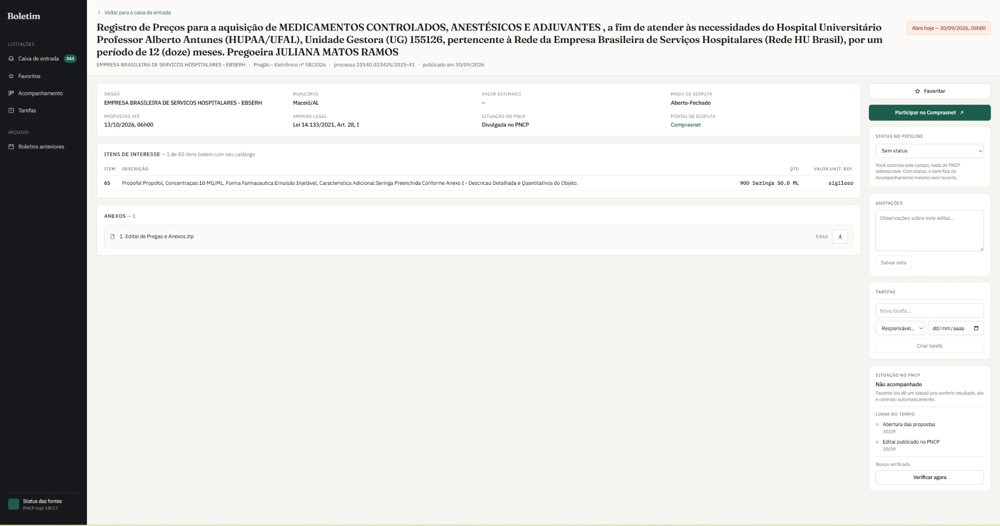

# Monitor de Licitações — Saúde

[English](README.en.md) · **Português**

[](https://github.com/Eduardo-Brrs/monitor-licitacoes-saude/actions/workflows/ci.yml)

Sistema de monitoramento de licitações públicas da área da saúde em Alagoas. Foi construído para uso interno de uma distribuidora de material médico-hospitalar, para substituir uma assinatura paga de alertas de licitação.

Todo dia o sistema varre as fontes oficiais de compras públicas, filtra o que interessa ao catálogo da empresa e entrega um **boletim diário** para triagem. Os editais escolhidos passam para um fluxo de gestão com etapas, tarefas, linha do tempo e detecção automática de resultado. O que a empresa ganha vira ata ou contrato, com controle de pedidos e saldo.

> **Status:** em uso interno, em produção desde agosto de 2026. Este repositório é um retrato do código publicado como portfólio; o desenvolvimento acontece num repositório privado, junto com os dados, as credenciais e a instância de produção.


<sub>Boletim do dia: editais do PNCP e avisos dos diários oficiais numa lista só, ordenada por prazo, com triagem por teclado (J/K navegar, F favoritar, D descartar).</sub>


<sub>Detalhe do edital: só os itens que batem com o catálogo (1 de 80, no exemplo), anexos, etapa, tarefas e linha do tempo.</sub>

---

## O problema

Uma empresa que vende para o governo precisa saber, todo dia, quais órgãos abriram compras dos produtos dela. Hoje isso passa por serviços pagos que agregam editais. A empresa usava um desses serviços, e as queixas de quem usava no dia a dia eram:

- **Feito para qualquer ramo, não para a área médica.** A plataforma atende de construtora a gráfica. Para o setor de saúde isso significa filtrar à mão boletins cheios de coisa que não interessa, e ainda assim perder oportunidades específicas do ramo, como as aquisições judiciais de OPME e medicamentos.
- **Opção demais.** A tela é cheia de módulos, menus, filtros e configurações, e a maioria não servia para nada no trabalho dele. O dono da empresa reclamava bastante da quantidade de coisa na plataforma: a sensação ao abrir era de ficar sobrecarregado antes mesmo de começar. O que ele queria era algo enxuto, fácil de usar e focado no ramo dele: abrir, ver o que chegou de novo e decidir em segundos.
- **Caro para o que entrega.** Paga-se pelo pacote inteiro e usa-se só uma fração dele.

Por isso o princípio do projeto é **fazer pouco e fazer certo**: só as funções que o usuário realmente usa, com o filtro afinado para o catálogo de uma distribuidora de material médico-hospitalar. Uma função chegou a ser descartada no planejamento (leitura de edital por IA) porque o serviço pago tinha e ninguém usava.

As informações são públicas, mas estão espalhadas:

- o **PNCP** (Portal Nacional de Contratações Públicas) tem API aberta, mas fica fora do ar com frequência e não traz tudo;
- **aquisições judiciais** (compras emergenciais que o Estado faz por ordem judicial, como OPME e medicamentos) e **cotações** saem só no **Diário Oficial do Estado**;
- prefeituras publicam avisos e cotações nos **diários oficiais municipais**, às vezes antes do PNCP.

O projeto junta essas fontes num só lugar, com um filtro afinado para o catálogo real da empresa.

## O que ele faz

### Encontrar

- **Captura automática, várias vezes por dia**, de quatro fontes:
  - PNCP: Pregão Eletrônico e Dispensa em AL;
  - Diário Oficial do Estado de Alagoas: aquisições judiciais, pregões estaduais e avisos de cotação;
  - diários municipais (AMA, Maceió e Maceió Saúde): avisos de licitação, dispensa e cotação.
- **Filtro por palavra-chave** com um motor de casamento de texto próprio (detalhes abaixo), organizado por segmento (materiais médico-hospitalares, equipamentos, gases medicinais, radiologia, dieta enteral, medicamentos, higiene) e cobrindo também laboratório e odontologia.
- **Checagem em segundo plano dos itens de cada compra.** Quando o objeto geral não bate nenhuma palavra-chave, os itens da compra vão para uma fila e são verificados um a um (ex.: "aquisição de equipamentos diversos" que tem um ultrassom no item 14).
- **Boletim do dia:** uma lista única ordenada por urgência, com triagem por teclado (visto / favoritar / descartar / desfazer).
- **Pesquisa de licitações:** busca por texto, órgão, cidade, estado, esfera e segmento numa lista só, juntando o que já está no sistema com uma **busca ao vivo no portal do PNCP**, em qualquer estado, para achar o que a captura automática não pegou. Os filtros ficam na URL, então uma busca pode ser salva nos favoritos do navegador e exportada em CSV.
- **Aviso ligado ao edital:** quando um aviso de diário oficial acompanhado aparece depois no PNCP, o sistema encontra o edital correspondente e liga os dois.

### Decidir e acompanhar

- **Tela do edital:** itens que batem com o catálogo, anexos (com cópia local da lista e download de todos em `.zip` via streaming) e link para o portal da disputa.
- **Gerenciar licitações:** cada licitação passa por uma escada de etapas (favoritada → gerenciada → em andamento → finalizada / ganha), com responsável e próxima tarefa na própria linha.
- **Finalizar com resultado:** ao encerrar, registra-se o que aconteceu (ganhou tudo, parte ou nada; anulada, fracassada, revogada; não participou) e o valor ganho.
- **Linha do tempo por licitação:** notas com autor e data, mudanças de etapa, tarefas criadas, respondidas e concluídas, e fatos do PNCP numa lista só. Nota editada guarda a versão anterior.
- **Resultado automático:** o sistema reconsulta o PNCP periodicamente e registra homologação, ata de registro de preços, contrato assinado e adiamento da abertura. Quando o vencedor tem o CNPJ da empresa, ele **sugere marcar como "ganha"** (nunca marca sozinho).
- **Tarefas** com responsável e prazo, agrupadas por atrasadas, próximos 7 dias e depois.

### Depois de ganhar

- **Atas e contratos:** substitui a planilha que a empresa usava. Cada ata tem itens ganhos, pedidos feitos e **saldo a pedir**, com abas por vigência (em vigor, vencendo em 60 dias, vencidas) e exportação na mesma estrutura da planilha antiga.

### Operação

- **Status das fontes:** uma tela com a saúde de cada captura (último sucesso, falhas seguidas, erro explicado em português). Ela acende um aviso global quando alguma fonte para de rodar ou responde "sucesso" sem nenhum item onde zero é anormal.
- **Vigia dos agendamentos:** confere 8 vezes por dia se cada rotina começou no horário; se não começou, roda a rotina ele mesmo e avisa por e-mail.
- **Arquivo** de boletins anteriores e **exportação CSV** compatível com o Excel em português (`;` + BOM).
- **Limpeza automática** de dados antigos, para o banco caber no plano grátis por anos.

## Arquitetura

```
 cron-job.org (agendador)                  Vercel (Next.js)                         Neon (Postgres)
┌──────────────────────┐   Bearer    ┌──────────────────────────────┐          ┌──────────────────────┐
│ sync             3x/d│────────────▶│ /api/sync          ─ PNCP    │─────────▶│ editais              │
│ sync-doe         3x/d│────────────▶│ /api/sync-doe      ─ DOE-AL  │─────────▶│ doe_al_*             │
│ sync-diarios     3x/d│────────────▶│ /api/sync-diarios-municipais │─────────▶│ diario_municipal_*   │
│ verificar-itens 30min│────────────▶│ /api/verificar-itens         │─────────▶│ itens_pendentes      │
│ atualizar-det.  30min│────────────▶│ /api/atualizar-detalhes      │          │ edital_status, notas │
│ acompanhar      30min│────────────▶│ /api/acompanhar              │─────────▶│ edital_eventos       │
└──────────────────────┘             │                              │          │ tarefas, atas        │
 GitHub Actions (reserva)            │ App Router + Server Actions  │◀────────▶│ sync_runs            │
┌──────────────────────┐             │ (boletim, pesquisa, atas…)   │          │ fila_falhas          │
│ vigia            8x/d│────────────▶│ /api/vigia                   │          └──────────────────────┘
│ CI    a cada push/PR │             └──────────────────────────────┘
└──────────────────────┘
```

**Stack:** Next.js 16 (App Router, Server Components, Server Actions) · React 19 · TypeScript · Tailwind CSS v4 · PostgreSQL serverless (Neon, driver `@neondatabase/serverless`) · Vercel · cron-job.org e GitHub Actions · `pdf-parse` para ler os diários oficiais. São **5 dependências em produção**; zip, CSV, testes e migrações usam código próprio ou o próprio Node.

## Engenharia

### Decisões registradas em ADRs

As decisões de arquitetura estão em [`docs/adr/`](docs/adr/README.md), no formato *Architecture Decision Record*: contexto, decisão, alternativas descartadas, consequências e uma seção **"Avaliação hoje"**, que diz se a decisão continua boa. Alguns exemplos:

- [0002](docs/adr/0002-fontes-e-agendamento.md): por que as fontes são só públicas, por que existe leitura de PDF como reserva e por que o agendador saiu do GitHub Actions;
- [0003](docs/adr/0003-filtro-por-keyword.md): por que o filtro é por palavra-chave no texto, e não por código de catálogo (CATMAT) ou IA;
- [0007](docs/adr/0007-login-e-senha.md): desenho do login (scrypt do `node:crypto`, sessão com hash no banco, três camadas de checagem e um teste que falha se uma Server Action nova esquecer de checar a sessão);
- [0012](docs/adr/0012-filas-resilientes.md): a regra de que erro em um item nunca para a fila;
- [0010](docs/adr/0010-revisao-e-licoes.md): uma revisão honesta das decisões, com o que deu certo, o que custou caro e as lições para o próximo projeto.

### Testes e CI

- **`npm test`** usa o executor de testes do próprio Node, sem dependência nova. Cobre o motor de palavras-chave, a fila resiliente, o vigia e a detecção de fonte zerada.
- **Teste de regressão com dado real:** mais de 800 objetos de compras reais do PNCP ficam num retrato (`tests/fixtures/objetos-pncp.json`) com as palavras-chave que cada um deve bater. Qualquer mudança no motor mostra exatamente o que cada objeto perdeu ou ganhou; mudar de propósito exige gravar o retrato novo no mesmo commit.
- **CI no GitHub Actions** a cada push e PR: gera os tipos das rotas do Next, roda `tsc --noEmit` e os testes. Deploy só sai com o CI verde.

### Banco com migrações versionadas

As mudanças de banco ficam em [`migrations/`](migrations), numeradas. `npm run migrate` aplica só as pendentes, cada arquivo inteiro numa transação, e grava um hash de cada uma: se um arquivo já aplicado for editado, o script avisa.

### Decisões técnicas que valem destacar

**Fontes instáveis são a regra, não a exceção.** O PNCP tem quedas reais e recorrentes, às vezes de mais de uma hora. Por isso:
- toda chamada externa tem timeout (`AbortSignal.timeout`), retry com backoff e um orçamento de tempo, para a função serverless nunca estourar o `maxDuration` sem registrar o que aconteceu;
- cada rodada reconsulta uma janela de vários dias (7 no PNCP, 14 no DOE-AL). A inserção é idempotente (`ON CONFLICT DO NOTHING` sobre chaves canônicas), então reconsultar não custa nada e uma queda de um dia não perde edital;
- toda execução vai para `sync_runs`, e é daí que saem a tela de status das fontes e o vigia.

**Erro em um item nunca para a fila** (`lib/fila.ts`). Isso aconteceu duas vezes: um edital travado no PNCP gastou 16 rodadas seguidas, e um PDF de 16 MB do Diário Oficial segurou as edições seguintes por mais de 38 horas. Hoje toda rotina que percorre itens passa pela mesma função, com isolamento de falha, rodízio (quem falhou vai para o fim da fila), orçamento de tempo e aviso quando um item fica preso por 24 horas. Um teste falha se uma rotina deixar de usá-la.

**Três camadas de reserva.** Isolamento e rodízio mantêm cada fila andando; o vigia roda a rotina que não começou; e as janelas de reconsulta e os caminhos alternativos de cada fonte recuperam o que passou. O guia [`docs/operacao.md`](docs/operacao.md) diz o que fazer em cada tipo de falha.

**Engenharia reversa de APIs não documentadas.** O Diário Oficial do Estado é uma SPA sem API documentada. Os endpoints foram mapeados a partir do bundle JS do próprio site. Quando a busca full-text deles travou num índice de meses atrás (sem erro, só respondendo com dado velho), foi implementado um caminho alternativo: listar as edições publicadas, baixar o PDF de cada uma e extrair os avisos localmente por regex sobre o formato fixo do registro. Também foi preciso lidar com edições republicadas com ID novo e com suplementos que têm o mesmo número da edição normal.

**Motor de palavras-chave feito sob medida** (`lib/keywords.ts`), refinado caso a caso comparando a captura com o boletim do serviço pago:
- normalização de acento e hífen, casamento por borda de palavra (para "maca" não bater em "informação");
- plural em cada palavra de termos compostos, incluindo os irregulares (`-al → -ais`, `colchão → colchões`, `álcool → álcoois`);
- tolerância a espaço dentro da palavra ("Ultra som" = "ultrassom"), com tratamento da dobra do "s" intervocálico;
- **termos compostos por presença**, sem exigir palavras adjacentes (`gás + medicinal` pega "Gás comprimido, nome: oxigênio… característica adicional: medicinal").

**Zip em streaming sem dependência** (`lib/zip.ts`). A resposta comum da Vercel tem teto de 4,5 MB, então o "baixar todos os anexos" monta um zip (modo *store*, CRC32 próprio) direto no stream: 4 downloads em paralelo, escritos na ordem. Testado com 40 anexos / 38 MB.

**Dados do fato × dados da captura.** A linha do tempo é só de acréscimo, com chave única por fato, e guarda separadamente quando o fato aconteceu e quando foi percebido.

## Estrutura

```
app/
  page.tsx, boletim/[dia]/     boletim do dia (+ exportação CSV)
  pesquisa/                    pesquisa no sistema + PNCP ao vivo
  edital/[numero]/             detalhe do edital, anexos (.zip)
  aviso/[fonte]/[id]/          aviso publicado só em diário oficial
  acompanhamento/, tarefas/    gerenciar licitações e tarefas
  atas/                        atas e contratos ganhos
  arquivo/, saude/             histórico e status das fontes
  actions/                     Server Actions
  api/                         rotas chamadas pelo agendador e pelo vigia
lib/
  pncp.ts, detalhe-pncp.ts, acompanhamento-pncp.ts   cliente do PNCP
  doe.ts, diario-municipal.ts                         diários oficiais
  keywords.ts                                         motor de palavras-chave
  fila.ts, vigia.ts, saude.ts                         resiliência e monitoramento
migrations/                    mudanças de banco versionadas
tests/                         testes (node:test) + retrato de dado real
components/                    UI por tela
docs/
  adr/                         decisões de arquitetura
  design/                      especificação de interface + protótipos HTML
  operacao.md                  o que fazer quando uma rotina para
.github/workflows/             CI, vigia e disparo manual das rotinas
```

## Rodando localmente

Pré-requisitos: Node 20+ e um banco PostgreSQL (o [Neon](https://neon.tech) tem plano gratuito).

```bash
npm install

# .env.local
DATABASE_URL=postgres://...
CRON_SECRET=qualquer-segredo    # protege as rotas /api/*
NOME_EMPRESA=Minha Empresa      # opcional; aparece na interface
CNPJ_EMPRESA=00000000000000     # opcional; liga a sugestão automática de "ganha"

npm run migrate   # aplica as migrações de migrations/
npm test          # testes
npm run dev
```

Para popular o banco, chame as rotas de captura:

```bash
curl -H "Authorization: Bearer $CRON_SECRET" http://localhost:3000/api/sync
curl -H "Authorization: Bearer $CRON_SECRET" http://localhost:3000/api/sync-doe
curl -H "Authorization: Bearer $CRON_SECRET" http://localhost:3000/api/sync-diarios-municipais
```

Em produção, quem chama essas rotas é o cron-job.org, com o vigia do GitHub Actions como reserva. Os workflows de rotina não rodam nesta cópia pública, que não tem os secrets; só o CI roda aqui.

## Como foi validado

Antes de ter interface, o sistema rodou semanas em paralelo com o serviço pago. Cada boletim recebido foi comparado item a item com o que estava no banco, e cada item perdido tinha a causa investigada: palavra-chave faltando, bug no motor de casamento, modalidade fora do escopo ou fonte que não estava sendo lida. Foi assim que surgiram as fontes do Diário Oficial e boa parte das regras do motor de palavras-chave, e é de lá que vêm os casos do teste de regressão. Nos boletins mais recentes, a captura empata ou passa o serviço pago dentro do escopo definido. O log dessa comparação cita dados internos da empresa e ficou fora deste repositório.

## Próximos passos

- Login com e-mail e senha ([ADR 0007](docs/adr/0007-login-e-senha.md))
- Pesquisa mais rápida: resultados do banco primeiro e os do PNCP ao vivo depois
- Avaliar a migração de hospedagem para o Cloudflare ([ADR 0011](docs/adr/0011-hospedagem.md))
- Medir o uso real com a equipe antes de construir mais
- Alerta por e-mail de edital novo e versão para celular

---

Desenvolvido por [@Eduardo-Brrs](https://github.com/Eduardo-Brrs).
